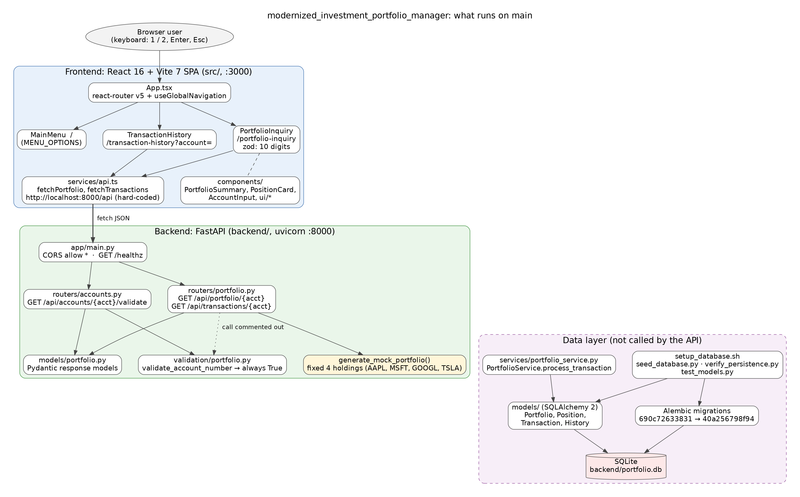

# modernized_investment_portfolio_manager
Modernized version of the COBOL Legacy Benchmark Suite (CLBS), a production-grade Investment Portfolio Management System

See [docs/architecture.md](docs/architecture.md) for how the frontend, API and data layer fit together.



## Repository layout

```
.
├── src/                 # React 16 + Vite SPA (pages, components, services/api.ts)
├── index.html           # Vite entry
├── vite.config.ts       # dev server on port 3000
├── backend/
│   ├── app/main.py      # FastAPI app (CORS, /healthz, routers)
│   ├── routers/         # /api/portfolio, /api/transactions, /api/accounts
│   ├── validation/      # field validation ported from COBOL
│   ├── models/          # Pydantic response models + SQLAlchemy ORM models
│   ├── services/        # PortfolioService (transaction processing, audit trail)
│   ├── migrations/      # Alembic schema history
│   ├── tests/           # pytest validation tests
│   ├── setup_database.sh, seed_database.py, verify_persistence.py
│   └── pyproject.toml   # Poetry dependencies
└── docs/                # architecture doc and diagram source
```

## Setup Instructions

### Prerequisites
- Node.js 20.19+ or 22.12+ and npm (required by Vite 7)
- Python 3.12+ and [Poetry](https://python-poetry.org/) (or pip)
- Git

### Installation

1. **Clone the repository**
   ```bash
   git clone https://github.com/COG-GTM/modernized_investment_portfolio_manager.git
   cd modernized_investment_portfolio_manager
   ```

2. **Install frontend dependencies**
   ```bash
   npm install
   ```

3. **Install backend dependencies** (from the repository root)
   ```bash
   cd backend
   python3 -m venv .venv && source .venv/bin/activate
   poetry install --no-root
   ```
   Use `pyproject.toml` (Poetry). `requirements.txt` pins FastAPI 0.68 and Pydantic 1.10.12, which fail to import on Python 3.12.

4. **Set up the database** (still in `backend/`)
   ```bash
   ./setup_database.sh
   ```
   This script will:
   - Run Alembic migrations to create the SQLite schema in `backend/portfolio.db`
   - Seed one sample portfolio (account `1234567890`)
   - Verify the setup was successful

   The API does not read this database yet: `/api/portfolio/{account}` returns fixed mock holdings for any account (see [docs/architecture.md](docs/architecture.md)).

### Running the Application

1. **Start the backend server**
   ```bash
   cd backend
   source .venv/bin/activate
   uvicorn app.main:app --reload --host 0.0.0.0 --port 8000
   ```

2. **Start the frontend development server** (from the repository root)
   ```bash
   npm run dev
   ```

3. **Access the application**
   - Frontend: http://localhost:3000
   - Backend API: http://localhost:8000
   - API Documentation: http://localhost:8000/docs

   The frontend calls `http://localhost:8000/api`, so the backend must run on port 8000.

### Tests and build

```bash
cd backend && pip install pytest && python -m pytest tests/ -v
npm run build
```

The 10 `TestValidateAccountNumber` tests fail on purpose: account number validation is disabled in `backend/validation/portfolio.py` to demonstrate an IDOR vulnerability.

### Database Management

Run these from `backend/`:
- Fresh setup: `./setup_database.sh`
- Manual seeding: `python seed_database.py`
- Verify data: `python verify_persistence.py`
