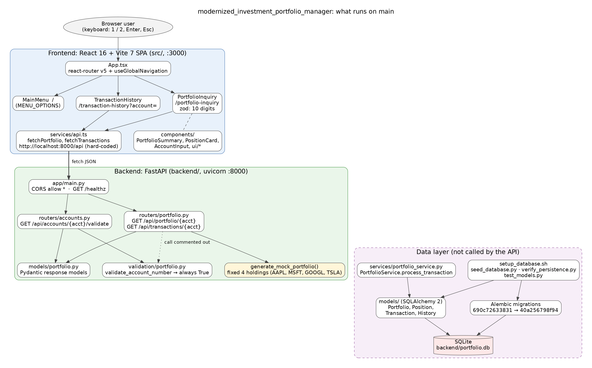

# Architecture

This page describes what the code on `main` does today. It is a two-process app: a React single-page app and a FastAPI service. A SQLAlchemy/Alembic data layer for SQLite also exists, but the API does not read from it yet.

The diagram source is [`diagrams/architecture.dot`](diagrams/architecture.dot) (Graphviz). Run `docs/diagrams/render.sh` after editing it to regenerate `architecture.png` and `architecture.svg`.

## Components

| Part | Where | What it does |
| --- | --- | --- |
| Frontend SPA | `src/` | React 16, react-router v5, Tailwind 4, built by Vite 7. The dev server runs on port 3000 (`vite.config.ts`). |
| API client | `src/services/api.ts` | `fetchPortfolio` and `fetchTransactions` call `http://localhost:8000/api` (hard-coded, no env override) and wrap failures in `ApiError`. |
| FastAPI app | `backend/app/main.py` | Mounts the two routers, allows CORS from every origin and serves `GET /healthz`. |
| Portfolio router | `backend/routers/portfolio.py` | `GET /api/portfolio/{account_number}` returns `generate_mock_portfolio()`: the same four holdings (AAPL, MSFT, GOOGL, TSLA) and totals for any account. `GET /api/transactions/{account_number}` returns an empty list with a placeholder message. |
| Accounts router | `backend/routers/accounts.py` | `GET /api/accounts/{account_number}/validate` returns the result of `validate_account_number`. The frontend does not call it. |
| Validation | `backend/validation/portfolio.py` | Ports of the COBOL field checks: portfolio ID (`PORT` + 4 digits), investment type, amount. `validate_account_number` is disabled and always returns `True, "Validation bypassed"` (an intentional IDOR demo). |
| Response models | `backend/models/portfolio.py` | Pydantic models for the API's JSON (`PortfolioSummary`, `PortfolioHolding`, `AccountValidationResponse`, ...). |
| ORM models | `backend/models/database.py`, `transactions.py`, `history.py` | SQLAlchemy 2 tables mapped from the CLBS VSAM records: `portfolios`, `positions`, `transactions`, `history` (audit trail with before/after JSON images). The engine points at `sqlite:///./portfolio.db`, relative to the working directory. |
| Transaction service | `backend/services/portfolio_service.py` | `PortfolioService.process_transaction` validates a transaction, updates positions or cash, writes `history` audit rows and moves the status to `D` (done) or `F` (failed). Only `backend/test_models.py` calls it. |
| Migrations | `backend/migrations/` | Alembic: `690c72633831` (initial schema) then `40a256798f94` (history table). |
| DB scripts | `backend/setup_database.sh` | Runs `alembic upgrade head`, `seed_database.py` (one portfolio `PF-12345` / account `1234567890` with the four positions and two buy transactions) and `verify_persistence.py`. |

## Request flow

1. The main menu (`/`) offers **Portfolio** (key `1`) and **History** (key `2`); `Esc` returns to the menu from any page (`useGlobalNavigation`).
2. On `/portfolio-inquiry` the user enters an account number. The form checks it with zod (exactly 10 digits) and calls `GET /api/portfolio/{account}`.
3. The backend skips validation (the call is commented out) and returns the mock portfolio. The page renders `PortfolioSummary` and one `PositionCard` per holding, and links to `/transaction-history?account=<account>`.
4. `/transaction-history` reads `account` from the query string and calls `GET /api/transactions/{account}`, which always returns no transactions.

## Data model

- `portfolios`: primary key (`port_id`, `account_no`); client name and type (`I`/`C`/`T`), status (`A`/`C`/`S`), total value, cash balance.
- `positions`: primary key (`portfolio_id`, `date`, `investment_id`); quantity, cost basis, market value, status (`A`/`C`/`P`).
- `transactions`: primary key (`date`, `time`, `portfolio_id`, `sequence_no`); type `BU`/`SL`/`TR`/`FE`, status `P`/`D`/`F`/`R`.
- `history`: primary key (`portfolio_id`, `date`, `time`, `seq_no`); record type `PT`/`PS`/`TR`, action `A`/`C`/`D`, before and after images as JSON text.

## Tests and checks

- `cd backend && python -m pytest tests/ -v`: 46 validation tests. The 10 `TestValidateAccountNumber` tests fail on `main` because account validation is bypassed on purpose.
- `cd backend && python test_models.py`: ORM and `PortfolioService` smoke test against the SQLite file.
- `npm run build`: `tsc` type check plus the Vite production build. There are no frontend tests or lint script.

## Origin

The app is a migration of the [COBOL Legacy Benchmark Suite](https://github.com/COG-GTM/COBOL-Legacy-Benchmark-Suite) (CLBS). Field names, status codes and record layouts in `backend/models/` follow its VSAM copybooks.
