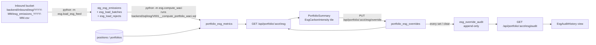

# ESG carbon intensity feed for the portfolio dashboard

Jira epic: RP-45 (stories RP-46 to RP-52). Status: specification, no code written yet.

## 1. Context

A data provider will start sending a monthly ESG emissions file for the holdings we manage. For each portfolio we need to compute weighted average carbon intensity (WACI, tCO2e per $M revenue), show it on the portfolio dashboard, let a portfolio manager override the value with a reason, and keep an append-only audit trail of overrides.

### 1.1 Findings from the codebase (scoping questions)

**Where an inbound feed should land and be loaded.** Nothing in the repo ingests files today. The only batch-style entry points are `backend/setup_database.sh` (runs `alembic upgrade head`, `seed_database.py`, `verify_persistence.py`) and the ad hoc scripts `backend/seed_database.py` and `backend/verify_persistence.py`, which all assume the working directory is `backend/` because `backend/models/database.py` hardcodes `SQLITE_DATABASE_URL = "sqlite:///./portfolio.db"`. The feed therefore lands under `backend/inbound/esg/` (local stand-in for the bucket, S3-style layout `esg/<YYYY-MM>/esg_emissions_<YYYY-MM>.csv`) and is loaded by a new CLI module run from `backend/`, wired into `setup_database.sh` after seeding.

**How portfolio values and positions are modelled.** `backend/models/database.py`:
- `Portfolio` (`portfolios`): composite PK `(port_id String(8), account_no String(10))`, `status` in `A/C/S`, `total_value`, `cash_balance` (`Numeric(15,2)`). `calculate_total_value()` sums `market_value` of positions with `status == 'A'` plus `cash_balance`.
- `Position` (`positions`): composite PK `(portfolio_id, date, investment_id)`, FK `portfolio_id -> portfolios.port_id`, `quantity Numeric(15,4)`, `cost_basis`, `market_value Numeric(15,2)`, `currency`, `status` in `A/C/P` (active, closed, pending). Positions are dated snapshots, so "active positions for a month" means the latest snapshot per `(portfolio_id, investment_id)` dated on or before the month end, with `status = 'A'`.
- `backend/models/transactions.py` (`Transaction`) and `backend/models/history.py` (`History`, the existing before/after-image audit table with `process_user String(8)`) are registered through `backend/models/__init__.py`.
- Seed data (`backend/seed_database.py`) creates one portfolio `PF-12345` / account `1234567890` with four positions `AAPL`, `MSFT`, `GOOGL`, `TSLA` dated `date.today()` (market values 27,787.50 / 37,885.00 / 10,692.00 / 49,134.00). Note `investment_id` values are tickers, not the 10-character IDs that `Position.validate_position()` expects; the feed's `investment_id` must match `positions.investment_id` as stored.

**How the portfolio summary API and `PortfolioSummary` component work.** `backend/routers/portfolio.py` exposes `GET /api/portfolio/{account_number}` returning the Pydantic `PortfolioSummary` from `backend/models/portfolio.py` (camelCase fields: `accountNumber`, `totalValue`, `holdings[]`, `lastUpdated`). It currently returns `generate_mock_portfolio()` and does not touch the database; account validation is intentionally bypassed (`backend/validation/portfolio.py`, IDOR demo). Routers are mounted in `backend/app/main.py` with `prefix="/api"`. On the frontend, `src/pages/PortfolioInquiry.tsx` calls `fetchPortfolio()` from `src/services/api.ts` (`API_BASE_URL = http://localhost:8000/api`, errors wrapped in `ApiError`), maps the response into the `Portfolio` type from `src/types/index.ts`, and renders `src/components/PortfolioSummary.tsx` (a `Card` with a three-tile KPI grid and a four-column detail row) followed by `PositionCard`s. Formatting helpers live in `src/utils/format.ts`; a focus-trapping modal pattern already exists in `src/components/dialogs/ConfirmationDialog.tsx`.

**How migrations and seed data are managed.** Alembic (`backend/alembic.ini`, `backend/migrations/env.py` with `target_metadata = Base.metadata`) with two revisions in `backend/migrations/versions/`: `690c72633831` (portfolios, positions, transactions) and `40a256798f94` (history). New tables are added as a third revision chained off `40a256798f94`, and their models must be imported in `backend/models/__init__.py` so autogenerate and `Base.metadata.create_all()` see them. Seeding is idempotent by checking for the sample portfolio first. The SQLite file `backend/portfolio.db` is git-ignored (`*.db` in `.gitignore`).

**What test tooling exists.** Backend: `pytest` 9 and `httpx` 0.28 are installed in `backend/.venv` (not declared in `backend/pyproject.toml`; `requirements.txt` is outdated and unused), with one test module `backend/tests/validation/test_portfolio.py` (pure function tests, run from `backend/` so that `validation`, `models`, `routers` import as top-level packages). There is no `conftest.py`, no DB fixture, and no API test. Ten `TestValidateAccountNumber` failures are expected because validation is bypassed. Frontend: `package.json` has no test runner or testing library (`scripts`: `dev`, `build`, `preview`); React is 16.14, which constrains us to `@testing-library/react` v12. CI: there is no `.github/workflows` directory.

## 2. Architecture



Data flow in words:
1. The provider drops `esg_emissions_<YYYY-MM>.csv` into `esg/<YYYY-MM>/` in the inbound bucket (locally `backend/inbound/esg/`).
2. The loader (`backend/esg/loader.py`, CLI `backend/esg/load_esg_feed.py`) hashes the file, registers a batch in `esg_load_batches`, validates each row, upserts good rows into `stg_esg_emissions` and writes bad rows to `esg_load_rejects` with a reason.
3. The WACI procedure (`backend/sql/esg/V001__compute_portfolio_waci.sql`, executed by the thin wrapper `backend/esg/waci.py`) joins staging to the latest active position snapshots for the month and upserts one row per portfolio into `portfolio_esg_metrics`.
4. `GET /api/portfolio/{account_number}/esg` (new router `backend/routers/esg.py`) returns the computed value, the effective value (override if present, otherwise computed), coverage and override details.
5. `PortfolioSummary` renders a carbon intensity tile; the override modal calls `PUT .../esg/override`, which writes `portfolio_esg_overrides` and appends to `esg_override_audit` in one transaction; `GET .../esg/audit` feeds the history view.

Component ownership (new files):

| Layer | Files |
| --- | --- |
| Loader | `backend/esg/__init__.py`, `backend/esg/loader.py`, `backend/esg/load_esg_feed.py` (CLI), `backend/inbound/esg/.gitkeep`, sample `backend/inbound/esg/2026-10/esg_emissions_2026-10.csv` |
| Procedure | `backend/sql/esg/V001__compute_portfolio_waci.sql`, `backend/esg/waci.py` (wrapper + CLI `compute_waci`) |
| Schema | `backend/models/esg.py` (SQLAlchemy models), `backend/models/__init__.py` (exports), `backend/migrations/versions/<rev>_add_esg_tables.py` |
| API | `backend/routers/esg.py`, `backend/schemas/esg.py` (Pydantic), `backend/services/esg_service.py`, `backend/models/database.py` (add `get_db()` dependency), `backend/app/main.py` (include router) |
| Frontend | `src/types/esg.ts`, `src/services/api.ts`, `src/components/EsgCarbonIntensity.tsx`, `src/components/dialogs/EsgOverrideDialog.tsx`, `src/components/EsgAuditHistory.tsx`, `src/components/PortfolioSummary.tsx`, `src/pages/PortfolioInquiry.tsx`, `src/components/index.ts` |
| Tests | `backend/tests/conftest.py`, `backend/tests/esg/test_loader.py`, `backend/tests/esg/test_waci_procedure.py`, `backend/tests/esg/test_esg_api.py`, `src/components/__tests__/PortfolioSummary.esg.test.tsx`, `src/components/__tests__/EsgOverrideDialog.test.tsx`, `src/components/__tests__/EsgAuditHistory.test.tsx`, `vite.config.ts` (vitest block), `package.json` (`test` script + dev deps) |
| Ops | `backend/setup_database.sh` (load sample feed and compute after seeding), `backend/pyproject.toml` (pytest, httpx dev group), `backend/README.md`, `README.md` |

## 3. Data model

All new tables are created in one Alembic revision (`add_esg_tables`, `down_revision = '40a256798f94'`) with matching SQLAlchemy models in `backend/models/esg.py`. Months are stored as `String(7)` in `YYYY-MM` form to match the file naming and keep SQLite comparisons simple.

### 3.1 `esg_load_batches` (one row per loaded file)

| Column | Type | Notes |
| --- | --- | --- |
| `batch_id` | Integer PK autoincrement | load batch id referenced by staging and rejects |
| `file_path` | String(255) not null | path relative to the inbound root, e.g. `esg/2026-10/esg_emissions_2026-10.csv` |
| `file_sha256` | String(64) not null, indexed | idempotency key; re-running the bytes of the month's latest completed batch is a no-op (see 5.1) |
| `as_of_month` | String(7) not null | derived from the folder/file name, must equal every row's `as_of_month` |
| `loaded_at` | DateTime not null | |
| `row_count` / `accepted_count` / `rejected_count` | Integer not null | row_count excludes the header |
| `status` | String(1) check in `('C','F')` | C complete, F failed (file-level problem: bad header, no data rows, or every row rejected) |
| `failure_reason` | String(30) nullable | `BAD_HEADER`, `EMPTY_FILE`, `ALL_ROWS_REJECTED`; NULL when status is C |

### 3.2 `stg_esg_emissions` (staging, one row per holding per month)

| Column | Type | Notes |
| --- | --- | --- |
| `as_of_month` | String(7) PK | |
| `investment_id` | String(10) PK | must match `positions.investment_id` as stored |
| `scope1_tco2e` | Numeric(18,4) not null | >= 0 |
| `scope2_tco2e` | Numeric(18,4) not null | >= 0 |
| `revenue_musd` | Numeric(18,4) nullable | NULL when the provider sends an empty value; must be > 0 when present |
| `batch_id` | Integer FK -> `esg_load_batches.batch_id` | batch that last wrote the row |
| `source_row_no` | Integer not null | 1-based data row number in the file |
| `loaded_at` | DateTime not null | |

Indexes: `idx_stg_esg_batch_id`. The PK `(as_of_month, investment_id)` plus upsert (`INSERT ... ON CONFLICT DO UPDATE`) means a corrected file for the same month replaces values instead of duplicating them. A successfully loaded file is the complete snapshot for its month: in the same transaction the loader deletes rows for that `as_of_month` whose `investment_id` was not accepted by the new batch, so a holding dropped from a corrected file becomes uncovered on the next recompute instead of keeping its superseded emissions. Batch rows and rejects are never deleted.

### 3.3 `esg_load_rejects`

| Column | Type | Notes |
| --- | --- | --- |
| `reject_id` | Integer PK autoincrement | |
| `batch_id` | Integer FK -> `esg_load_batches.batch_id` | |
| `source_row_no` | Integer not null | |
| `raw_line` | Text not null | the CSV line as received |
| `reason` | String(200) not null | one of the reason codes in section 5.1 |
| `rejected_at` | DateTime not null | |

### 3.4 `portfolio_esg_metrics` (procedure output)

| Column | Type | Notes |
| --- | --- | --- |
| `port_id` | String(8) PK, FK -> `portfolios.port_id` | |
| `as_of_month` | String(7) PK | |
| `computed_value` | Numeric(18,6) nullable | WACI in tCO2e per $M revenue; NULL when coverage is 0, total market value is 0, or the portfolio has no active positions |
| `coverage_pct` | Numeric(7,4) not null | covered market value / total active market value * 100, 0 when total is 0 |
| `total_market_value` | Numeric(18,2) not null | sum of active position market value for the month (excludes cash) |
| `covered_market_value` | Numeric(18,2) not null | subset with emissions and positive revenue |
| `positions_total` / `positions_covered` | Integer not null | |
| `procedure_version` | String(20) not null | e.g. `V001` from the SQL script name |
| `computed_at` | DateTime not null | |

Every portfolio gets exactly one row per computed month, including portfolios with no active position at month end; that row has `positions_total 0`, `total_market_value 0`, `coverage_pct 0` and `computed_value NULL` and is the explicit "no metric" state. Writing it (rather than deleting or skipping) is what stops an older month from resurfacing as the current value when a portfolio's last holding is closed.

### 3.5 `portfolio_esg_overrides` (current override, at most one per portfolio-month)

| Column | Type | Notes |
| --- | --- | --- |
| `port_id` | String(8) PK, FK -> `portfolios.port_id` | |
| `as_of_month` | String(7) PK | |
| `override_value` | Numeric(18,6) not null | >= 0 |
| `reason` | Text not null | >= 10 characters after trimming |
| `overridden_by` | String(8) not null | same width as `history.process_user` and `portfolios.last_user` |
| `overridden_at` | DateTime not null | |

Clearing an override deletes this row inside the same transaction that appends the `CLEAR` audit entry. Keeping overrides out of `portfolio_esg_metrics` means the procedure can be re-run freely without touching manager input.

### 3.6 `esg_override_audit` (append-only)

| Column | Type | Notes |
| --- | --- | --- |
| `audit_id` | Integer PK autoincrement | |
| `port_id` | String(8) not null, FK -> `portfolios.port_id` | |
| `account_no` | String(10) not null | denormalised for reporting |
| `as_of_month` | String(7) not null | |
| `action` | String(5) check in `('SET','CLEAR')` | |
| `old_value` | Numeric(18,6) nullable | effective value before the change (computed value if no prior override) |
| `new_value` | Numeric(18,6) nullable | NULL on CLEAR |
| `reason` | Text not null | |
| `changed_by` | String(8) not null | |
| `changed_at` | DateTime not null | |

Index `idx_esg_audit_port_month (port_id, as_of_month, changed_at)`. The migration also creates two SQLite triggers, `trg_esg_override_audit_no_update` and `trg_esg_override_audit_no_delete`, each `BEFORE UPDATE/DELETE ... RAISE(ABORT, 'esg_override_audit is append-only')`, and the service layer never issues updates or deletes against the table.

## 4. API contract

All three endpoints live in `backend/routers/esg.py` under the existing `/api` prefix and resolve `account_number -> portfolios.port_id` through the database (unlike the current mock `GET /api/portfolio/{account_number}`). Field names follow the repo's existing camelCase JSON convention (`accountNumber`, `totalValue`); the mapping to the story wording is `as_of_month -> asOfMonth`, `computed_value -> computedValue`, `effective_value -> effectiveValue`, `coverage_pct -> coveragePct`.

Shared error shapes: `404 {"detail": "Account not found"}` when no portfolio row has that `account_no`; `422` uses FastAPI's default validation error body; `409 {"detail": "No ESG metric exists for this account yet"}` when an override is attempted before any metric has been computed.

### 4.1 `GET /api/portfolio/{account_number}/esg`

Returns the metric for the portfolio's current as-of month (the greatest `as_of_month` in `portfolio_esg_metrics` for that `port_id`). If that row has `positions_total = 0` the response uses the `hasMetric: false` shape below with `asOfMonth` and `computedAt` populated from the row (and `override` populated if one exists for that month, so the UI can still offer "Clear override"); the UI must never fall back to an earlier month. `hasMetric: false` with `asOfMonth: null` means nothing has ever been computed for the portfolio.

200 with an override in place:
```json
{
  "accountNumber": "1234567890",
  "portfolioId": "PF-12345",
  "hasMetric": true,
  "asOfMonth": "2026-10",
  "metric": "WACI",
  "unit": "tCO2e per $M revenue",
  "computedValue": 64.137484,
  "effectiveValue": 70.0,
  "source": "override",
  "coveragePct": 91.48,
  "computedAt": "2026-10-29T14:05:12",
  "override": {
    "value": 70.0,
    "reason": "Provider revenue for TSLA restated; aligned to Q3 filing.",
    "overriddenBy": "PMJONES",
    "overriddenAt": "2026-10-29T15:21:40"
  }
}
```

200 with no override: identical, with `"effectiveValue": 64.137484`, `"source": "computed"`, `"override": null`.

200 for a known account with no metric yet (dashboard empty state):
```json
{
  "accountNumber": "1234567890",
  "portfolioId": "PF-12345",
  "hasMetric": false,
  "asOfMonth": null,
  "metric": "WACI",
  "unit": "tCO2e per $M revenue",
  "computedValue": null,
  "effectiveValue": null,
  "source": "none",
  "coveragePct": null,
  "computedAt": null,
  "override": null
}
```

404 for an unknown account.

### 4.2 `PUT /api/portfolio/{account_number}/esg/override`

Request:
```json
{
  "value": 70.0,
  "reason": "Provider revenue for TSLA restated; aligned to Q3 filing.",
  "changedBy": "PMJONES"
}
```

Rules (Pydantic model `EsgOverrideRequest` in `backend/schemas/esg.py`): `value` is a number `>= 0`; `reason` is a string whose trimmed length is `>= 10`; `changedBy` is optional, 1 to 8 characters, defaults to `"SYSTEM"` (the application has no authentication today, see open questions). The override always applies to the portfolio's current as-of month; the client cannot choose a month.

Responses: `200` with the same body as 4.1 (now `source: "override"`); `404` unknown account; `409` no metric yet; `422` validation failure, for example:
```json
{
  "detail": [
    {"loc": ["body", "reason"], "msg": "Reason must be at least 10 characters", "type": "value_error"},
    {"loc": ["body", "value"], "msg": "Input should be greater than or equal to 0", "type": "greater_than_equal"}
  ]
}
```

Side effects in one transaction: upsert `portfolio_esg_overrides`; append `esg_override_audit` row with `action = 'SET'`, `old_value` = previous effective value, `new_value` = request value.

### 4.3 `DELETE /api/portfolio/{account_number}/esg/override`

Clears the current override. Request body `{"reason": "Provider corrected the file in the November drop.", "changedBy": "PMJONES"}` with the same reason rule. Responses: `200` with the 4.1 body (`source: "computed"`); `404` unknown account or no override present; `422` validation. Side effects: delete the `portfolio_esg_overrides` row and append an audit row with `action = 'CLEAR'`, `old_value` = override value, `new_value = null`.

### 4.4 `GET /api/portfolio/{account_number}/esg/audit?limit=50`

```json
{
  "accountNumber": "1234567890",
  "portfolioId": "PF-12345",
  "entries": [
    {
      "auditId": 2,
      "asOfMonth": "2026-10",
      "action": "CLEAR",
      "oldValue": 70.0,
      "newValue": null,
      "reason": "Provider corrected the file in the November drop.",
      "changedBy": "PMJONES",
      "changedAt": "2026-10-30T09:02:11"
    },
    {
      "auditId": 1,
      "asOfMonth": "2026-10",
      "action": "SET",
      "oldValue": 64.137484,
      "newValue": 70.0,
      "reason": "Provider revenue for TSLA restated; aligned to Q3 filing.",
      "changedBy": "PMJONES",
      "changedAt": "2026-10-29T15:21:40"
    }
  ]
}
```

Ordered by `changed_at DESC, audit_id DESC`. `limit` is optional, default 50, max 500. `entries` is `[]` for a known account with no history; `404` for an unknown account.

## 5. Calculation definition

### 5.1 Loader rules (RP-46)

File contract: UTF-8 CSV with header exactly `as_of_month,investment_id,scope1_tco2e,scope2_tco2e,revenue_musd`, located at `esg/<YYYY-MM>/esg_emissions_<YYYY-MM>.csv`. The loader:

1. Computes the SHA-256 of the file and derives `as_of_month` from the path. If the month's latest batch with status `C` has the same `file_sha256`, logs "already loaded as batch N" and exits 0 without writing anything (idempotent re-run). A matching hash on an older, superseded batch does not short-circuit: replaying the provider's original file after a correction is a new batch that restores that snapshot, so a withdrawn correction can be undone by reloading the earlier file. Batch rows are never updated or deleted.
2. Validates the header; on mismatch writes a batch with status `F`, `failure_reason BAD_HEADER` and exits 1.
3. For each data row applies, in order, the reject reasons: `INVALID_AS_OF_MONTH` (not `YYYY-MM` or not equal to the folder month), `MISSING_INVESTMENT_ID` (empty or longer than 10 characters), `INVALID_SCOPE1` / `INVALID_SCOPE2` (non-numeric or negative), `INVALID_REVENUE` (non-numeric, zero or negative when present; empty is accepted as NULL), `DUPLICATE_INVESTMENT_ID` (second occurrence in the same file), `WRONG_COLUMN_COUNT`.
   If the file has no data rows (`EMPTY_FILE`) or every data row is rejected (`ALL_ROWS_REJECTED`), the batch is written with status `F` and that `failure_reason`, the rejects are written for diagnosis, staging is left untouched (the month keeps its last valid snapshot) and the loader exits 1. The feed cannot intentionally empty a month; that would be an operator action, not a file.
4. Upserts accepted rows into `stg_esg_emissions` keyed by `(as_of_month, investment_id)`, deletes staging rows for the same month whose `investment_id` is not among the accepted rows (the file replaces the month's snapshot), and inserts rejects into `esg_load_rejects`, all in one transaction with the batch row. A batch with status `F` never changes staging.
5. Unknown `investment_id`s (no matching position) are accepted; the provider's universe is wider than our holdings.

### 5.2 WACI procedure (RP-47)

`backend/sql/esg/V001__compute_portfolio_waci.sql` is a parameterised script (`:as_of_month`, `:computed_at`, `:procedure_version`) executed by `backend/esg/waci.py::compute_waci(session, as_of_month)`. It is a single statement driven from `portfolios`, so every portfolio receives a row for the month, including those with no active position (otherwise a portfolio whose last holding was closed would keep serving a stale value, and deleting its row would let an older month resurface as current). Logic, all in SQL:

```sql
WITH month_end AS (
  SELECT date(:as_of_month || '-01', '+1 month', '-1 day') AS d
),
latest_snapshot AS (                      -- last snapshot per holding on or before month end
  SELECT p.portfolio_id, p.investment_id, p.market_value, p.status,
         ROW_NUMBER() OVER (PARTITION BY p.portfolio_id, p.investment_id ORDER BY p.date DESC) AS rn
  FROM positions p, month_end
  WHERE p.date <= month_end.d
),
active_positions AS (
  SELECT portfolio_id, investment_id, market_value
  FROM latest_snapshot
  WHERE rn = 1 AND status = 'A' AND market_value IS NOT NULL
),
joined AS (
  SELECT a.portfolio_id, a.investment_id, a.market_value,
         e.scope1_tco2e, e.scope2_tco2e, e.revenue_musd,
         CASE WHEN e.revenue_musd > 0 THEN 1 ELSE 0 END AS covered
  FROM active_positions a
  LEFT JOIN stg_esg_emissions e
    ON e.investment_id = a.investment_id AND e.as_of_month = :as_of_month
),
totals AS (                              -- one row per portfolio, even with no active positions
  SELECT pf.port_id                                            AS portfolio_id,
         SUM(j.market_value)                                   AS total_mv,
         SUM(CASE WHEN j.covered = 1 THEN j.market_value END)  AS covered_mv,
         COUNT(j.investment_id)                                AS positions_total,
         SUM(j.covered)                                        AS positions_covered,
         SUM(CASE WHEN j.covered = 1
                  THEN 1.0 * j.market_value * (j.scope1_tco2e + j.scope2_tco2e) / j.revenue_musd END) AS weighted_sum
  FROM (SELECT DISTINCT port_id FROM portfolios) pf
  LEFT JOIN joined j ON j.portfolio_id = pf.port_id
  GROUP BY pf.port_id
)
INSERT INTO portfolio_esg_metrics (port_id, as_of_month, computed_value, coverage_pct, total_market_value,
                                   covered_market_value, positions_total, positions_covered,
                                   procedure_version, computed_at)
SELECT portfolio_id, :as_of_month,
       CASE WHEN covered_mv > 0 THEN weighted_sum / (1.0 * covered_mv) END,
       CASE WHEN total_mv > 0 THEN 100.0 * COALESCE(covered_mv, 0) / total_mv ELSE 0 END,
       COALESCE(total_mv, 0), COALESCE(covered_mv, 0), positions_total, COALESCE(positions_covered, 0),
       :procedure_version, :computed_at
FROM totals
WHERE true   -- required by SQLite so the upsert clause is not parsed as a join
ON CONFLICT (port_id, as_of_month) DO UPDATE SET
  computed_value = excluded.computed_value, coverage_pct = excluded.coverage_pct,
  total_market_value = excluded.total_market_value, covered_market_value = excluded.covered_market_value,
  positions_total = excluded.positions_total, positions_covered = excluded.positions_covered,
  procedure_version = excluded.procedure_version, computed_at = excluded.computed_at;
```

The script above was dry-run against SQLite 3.37 with the section 5.3 data plus a holding sold mid-month, a zero-value portfolio, a whole-number-only portfolio (market value 100, emissions 1, revenue 2) and a portfolio whose only holding was closed between two runs; it produced `64.13748350485382 / 91.48037625947721` for `PF-12345`, excluded the sold holding, returned `NULL / 0` for the zero-value portfolio, `0.5` (not `0`) for the whole-number portfolio, rewrote the closed portfolio's row to `positions_total 0 / NULL / 0` on the second run, and left exactly one row per portfolio.

The `1.0 *` factors matter: SQLite stores whole-number `Numeric` values as integers, so `100 * 1 / 2 / 100` would evaluate to `0` under integer division. Forcing real arithmetic before the first division keeps each holding's contribution exact; on a decimal-capable database the factor is harmless.

Definitions:
- `weight_i = market_value_i / covered_market_value`, i.e. weights are renormalised over the holdings that have emissions and positive revenue, so WACI describes the covered part of the book and `coverage_pct` tells the reader how much of the book that is. Cash is not part of either denominator.
- `WACI = sum(weight_i * (scope1_i + scope2_i) / revenue_musd_i)`; since `weight_i` already divides by `covered_market_value`, the script computes `sum(mv_i * intensity_i) / covered_mv`.
- A holding with no staging row or `revenue_musd IS NULL` is excluded from the numerator and from `covered_market_value` but stays in `total_market_value`, which is how it "counts against coverage".
- A position whose latest snapshot on or before month end has `status <> 'A'` (sold or closed mid-month) is excluded from both totals.
- `total_mv = 0` yields `coverage_pct = 0` and `computed_value = NULL` (no division). `covered_mv = 0` yields `computed_value = NULL` and `coverage_pct = 0`.
- Re-running for the same month upserts the same `(port_id, as_of_month)` row, so the result set is identical and no duplicates appear. Portfolios with no active positions at month end get the explicit no-position row (`positions_total 0`, `computed_value NULL`, `coverage_pct 0`), overwriting whatever an earlier run wrote for that month, and the API returns `hasMetric: false` for it rather than falling back to an older month. An override for that portfolio-month stays in `portfolio_esg_overrides` and remains visible in the audit trail.
- Future script changes are new files (`V002__...`); `procedure_version` records which one produced each row. The wrapper picks the highest version present in `backend/sql/esg/`.

### 5.3 Worked numeric example

Using the seeded portfolio `PF-12345` (account `1234567890`) and this October 2026 file:

```
as_of_month,investment_id,scope1_tco2e,scope2_tco2e,revenue_musd
2026-10,AAPL,10,40,2.5
2026-10,MSFT,15,60,1.5
2026-10,GOOGL,8,22,
2026-10,TSLA,120,180,3.0
2026-10,NVDA,5,-3,4.0
```

Loader: `NVDA` is rejected (`INVALID_SCOPE2`, negative). `GOOGL` is accepted with `revenue_musd = NULL`. Batch row: `row_count 5, accepted 4, rejected 1`.

Procedure:

| Holding | Market value | Intensity (s1+s2)/revenue | Covered |
| --- | ---: | ---: | --- |
| AAPL | 27,787.50 | 50 / 2.5 = 20 | yes |
| MSFT | 37,885.00 | 75 / 1.5 = 50 | yes |
| GOOGL | 10,692.00 | revenue missing | no |
| TSLA | 49,134.00 | 300 / 3.0 = 100 | yes |

- `total_market_value = 125,498.50`; `covered_market_value = 114,806.50`
- `coverage_pct = 114,806.50 / 125,498.50 * 100 = 91.48`
- weights over covered: AAPL 0.242038, MSFT 0.329990, TSLA 0.427972
- `WACI = 0.242038 * 20 + 0.329990 * 50 + 0.427972 * 100 = 4.8408 + 16.4995 + 42.7972 = 64.137484 tCO2e per $M revenue`

API: `computedValue 64.137484`, `coveragePct 91.48`, `source "computed"`. After `PUT .../esg/override {"value": 70.0, ...}`: `effectiveValue 70.0`, `source "override"`, one `SET` audit row with `oldValue 64.137484`, `newValue 70.0`.

## 6. Stories

| Jira key | Story | Files that change | Tests that prove it |
| --- | --- | --- | --- |
| RP-46 | Ingest monthly ESG feed into staging | `backend/esg/__init__.py`, `backend/esg/loader.py`, `backend/esg/load_esg_feed.py`, `backend/models/esg.py` (`EsgLoadBatch`, `StgEsgEmission`, `EsgLoadReject`), `backend/models/__init__.py`, `backend/migrations/versions/<rev>_add_esg_tables.py`, `backend/inbound/esg/.gitkeep`, `backend/inbound/esg/2026-10/esg_emissions_2026-10.csv`, `backend/setup_database.sh` | `backend/tests/esg/test_loader.py`: happy path counts, duplicate file is a no-op, negative emissions rejected with reason, empty revenue loads as NULL, zero/negative revenue rejected, bad header fails the batch, duplicate `investment_id` in file rejected, corrected file that drops a previously accepted holding removes its staging row, replaying the original file after a correction restores it as a new batch, all-rows-rejected and header-only files get status `F` and leave staging untouched |
| RP-47 | Compute WACI per portfolio in a database procedure | `backend/sql/esg/V001__compute_portfolio_waci.sql`, `backend/esg/waci.py`, `backend/models/esg.py` (`PortfolioEsgMetric`), migration | `backend/tests/esg/test_waci_procedure.py`: worked example equals 64.137484 / 91.48, missing revenue excluded and lowers coverage, zero total market value gives NULL value and 0 coverage without error, position sold mid-month (latest snapshot `status 'C'`) excluded, rerun leaves exactly one row with same values, portfolio with no emissions coverage gives NULL value, whole-number inputs (mv 100, emissions 1, revenue 2) give 0.5 not 0, rerun after the last holding closes rewrites the row as the no-position state (`positions_total 0`, NULL value) |
| RP-48 | Expose carbon intensity through the portfolio API | `backend/routers/esg.py`, `backend/schemas/esg.py`, `backend/services/esg_service.py`, `backend/models/database.py` (`get_db`), `backend/app/main.py` | `backend/tests/esg/test_esg_api.py::TestGetEsg`: computed payload, override payload, `hasMetric false` payload (never computed), `hasMetric false` when the latest month is a no-position row even though an older month has a value, 404 unknown account |
| RP-49 | Show carbon intensity on the portfolio dashboard | `src/types/esg.ts`, `src/services/api.ts` (`fetchEsgMetric`), `src/components/EsgCarbonIntensity.tsx`, `src/components/PortfolioSummary.tsx`, `src/pages/PortfolioInquiry.tsx`, `src/components/index.ts` | `src/components/__tests__/PortfolioSummary.esg.test.tsx`: computed state shows value + unit + as-of month + coverage, override state shows indicator, empty state text, loading and error states |
| RP-50 | Override with a reason | `backend/schemas/esg.py` (`EsgOverrideRequest`), `backend/routers/esg.py` (PUT/DELETE), `backend/services/esg_service.py`, `backend/models/esg.py` (`PortfolioEsgOverride`), `src/components/dialogs/EsgOverrideDialog.tsx`, `src/services/api.ts` (`putEsgOverride`, `clearEsgOverride`) | `backend/tests/esg/test_esg_api.py::TestOverride`: set, replace, clear, reason < 10 chars 422, negative value 422, 409 with no metric, 404 unknown account, applies only to current month; `src/components/__tests__/EsgOverrideDialog.test.tsx`: client-side validation messages, server 422 shown, submit calls API and closes |
| RP-51 | Audit trail | `backend/models/esg.py` (`EsgOverrideAudit`), migration (triggers), `backend/services/esg_service.py`, `backend/routers/esg.py` (GET audit), `src/components/EsgAuditHistory.tsx`, `src/services/api.ts` (`fetchEsgAudit`) | `backend/tests/esg/test_esg_api.py::TestAudit`: SET then CLEAR yields two rows newest first with correct old/new values, UPDATE/DELETE on the table raises, empty list for account without history, 404 unknown account; `src/components/__tests__/EsgAuditHistory.test.tsx`: renders rows newest first, empty state |
| RP-52 | Automated tests | `backend/tests/conftest.py` (in-memory SQLite engine, `create_all`, `TestClient` with `get_db` override), `backend/pyproject.toml` (dev group: pytest, httpx), `package.json` (`vitest`, `jsdom`, `@testing-library/react@12`, `@testing-library/jest-dom`, `@testing-library/user-event`, `test` script), `vite.config.ts` (test block), `src/test/setup.ts` | the whole suite above; `cd backend && python -m pytest tests/ -v` and `npm test` are the commands |

Every commit message carries its Jira key (and "feature" per repo convention), for example `feature(RP-46): add ESG feed loader and staging tables`.

## 7. Acceptance criteria per story

**RP-46 Ingest**
- Running `python -m esg.load_esg_feed --file inbound/esg/2026-10/esg_emissions_2026-10.csv` from `backend/` creates one `esg_load_batches` row with correct counts and populates `stg_esg_emissions` and `esg_load_rejects`.
- Running the same command again writes nothing new (batch count, staging count and rejects count unchanged) and exits 0.
- Rows with negative scope values, non-numeric fields, bad month or duplicate `investment_id` land in `esg_load_rejects` with the reason codes in 5.1; empty `revenue_musd` is accepted as NULL.
- Loading a corrected file for an already loaded month that omits a previously accepted `investment_id` removes that holding's `stg_esg_emissions` row; the earlier batch row and its rejects remain. Reloading the original file afterwards creates a new batch and restores the holding.
- A file with the right header but no data rows, or with every row rejected, writes a batch with status `F` (`EMPTY_FILE` / `ALL_ROWS_REJECTED`), writes its rejects, leaves `stg_esg_emissions` unchanged and exits 1.
- `--all` scans `inbound/esg/*/` and loads every file not yet loaded.

**RP-47 Procedure**
- `python -m esg.compute_waci --as-of-month 2026-10` produces one `portfolio_esg_metrics` row per portfolio with active positions, values matching section 5.3 to six decimals.
- Missing revenue reduces `coverage_pct` and never enters the numerator.
- A portfolio whose active market value is zero gets `coverage_pct 0` and `computed_value NULL`, no exception.
- A holding sold before month end (latest snapshot `status 'C'`) is excluded from both numerator and denominator.
- Rerunning for the same month leaves the row count unchanged and only `computed_at` differs.
- A portfolio with only whole-number inputs (market value 100, emissions 1, revenue 2) gets `computed_value 0.5`, not `0`.
- Rerunning after a portfolio's last active holding has a closed snapshot dated in the month rewrites its `portfolio_esg_metrics` row as the no-position state, and `GET .../esg` returns `hasMetric: false` even when an earlier month has a value.
- The calculation lives entirely in `backend/sql/esg/V001__compute_portfolio_waci.sql`; `waci.py` only binds parameters, executes and commits.

**RP-48 API**
- `GET /api/portfolio/1234567890/esg` returns the 4.1 payload with `source` in `computed | override | none`.
- Unknown account returns 404 with `{"detail": "Account not found"}`.
- `effectiveValue` equals `override.value` when an override exists, otherwise `computedValue`.
- When the latest month's row has `positions_total 0`, the response is `hasMetric: false` with that month's `asOfMonth`; an older month's value is never returned as current.

**RP-49 Dashboard**
- `PortfolioSummary` shows a "Carbon intensity (WACI)" tile with the effective value formatted to two decimals, the unit `tCO2e / $M revenue`, "As of <Month YYYY>" and "Coverage <n>%".
- When `source === 'override'` the tile shows an "Override" badge and the computed value as secondary text.
- When `hasMetric === false` the tile shows "No carbon intensity data for this portfolio yet".
- The tile does not block or break the existing summary when the ESG request fails (error text inside the tile, rest of the page unchanged).

**RP-50 Override**
- "Override" button on the tile opens a modal (focus-trapped, Escape closes, same pattern as `ConfirmationDialog`) with value and reason fields.
- Client validation mirrors the server: value required and >= 0, reason >= 10 characters; the submit button stays disabled until valid.
- Server 422 messages are shown inline; on 200 the tile updates to the override state without a page reload.
- "Clear override" is available when an override is active and also requires a reason.
- The server stores the override against the portfolio's current as-of month only.

**RP-51 Audit**
- Every SET and CLEAR appends exactly one `esg_override_audit` row; no code path updates or deletes rows and the database triggers reject attempts.
- `GET .../esg/audit` returns newest first with who, when, old value, new value, reason and month.
- "History" link on the tile opens a panel listing the entries; empty state reads "No override history".

**RP-52 Tests**
- `cd backend && python -m pytest tests/esg -v` passes; the full suite still has only the 10 pre-existing `TestValidateAccountNumber` failures.
- `npm test` passes and `npm run build` (tsc + vite) stays green.
- Tests cover at minimum: duplicate file, missing revenue, zero market value, position sold mid-month, negative emissions rejected, the three endpoints, and dashboard computed / override / empty states.

## 8. Test plan

Backend (pytest, run from `backend/` with the Poetry venv):
- `tests/conftest.py`: `engine` fixture using `sqlite://` in-memory with `StaticPool`, `Base.metadata.create_all` plus the audit triggers (applied from the same helper the migration uses), `session` fixture, `client` fixture overriding `get_db`, and data builders `make_portfolio(port_id, account_no)` and `make_position(port_id, investment_id, date, market_value, status)`.
- `tests/esg/test_loader.py`: writes CSV fixtures to `tmp_path` mimicking `esg/<month>/` and asserts batch/staging/reject counts and reason codes; duplicate-file test loads twice and asserts counts unchanged; header test asserts status `F`; corrected-file test loads a second file for the same month without one holding and asserts that holding's staging row is gone while batch and reject rows are retained, then reloads the first file and asserts the holding is back under a third batch; all-rows-rejected and header-only tests assert status `F`, the `failure_reason`, and unchanged staging.
- `tests/esg/test_waci_procedure.py`: seeds the worked example, runs `compute_waci`, asserts `computed_value == Decimal('64.137484')` and `coverage_pct == Decimal('91.48')` (rounded), then the edge cases listed in section 6, including the whole-number regression (asserts `0.5`) and the stale-metric case (compute September and October, add a closed snapshot for the last holding in October, recompute October, assert the October row has `positions_total 0` and NULL value and that GET returns `hasMetric: false`, not September).
- `tests/esg/test_esg_api.py`: `TestClient` tests for GET esg (three states + 404), PUT/DELETE override (validation matrix, 409, audit side effects, current-month rule when two months exist), GET audit (ordering, limit, 404), and a direct `UPDATE`/`DELETE` on `esg_override_audit` expecting an `IntegrityError`/`OperationalError` from the trigger.

Frontend (vitest + jsdom + Testing Library v12 for React 16):
- `PortfolioSummary.esg.test.tsx`: render with `esg` prop in computed, override, empty, loading and error shapes; assert texts and badge.
- `EsgOverrideDialog.test.tsx`: typing a 5-character reason shows the validation message and keeps submit disabled; a negative value shows its message; a mocked 422 response renders the server message; a mocked 200 calls `onSaved`.
- `EsgAuditHistory.test.tsx`: entries render newest first; empty list renders the empty state.

Manual verification before merge (recorded by the implementing session): `./setup_database.sh` loads the sample file and computes the metric; open the dashboard for `1234567890`, see the tile, set an override, see the badge, open history, clear the override, see two audit rows.

Regression: `npm run build` and the existing `tests/validation` module stay unchanged (still the 10 known failures).

## 9. Risks and open questions

Risks
- `GET /api/portfolio/{account_number}` is still mock data while the ESG endpoints read the real database. The dashboard will show mock holdings next to a real WACI; the seeded account `1234567890` is the only one where both agree. Converting the summary endpoint to the database is out of scope here but should follow.
- Seeded positions are dated `date.today()`, so a fixed sample file for `2026-10` only lines up with the seed in October 2026. `setup_database.sh` should write the sample file into the current month's folder (templating the month) so the demo works in any month.
- Seeded `investment_id`s are tickers while `Position.validate_position()` expects 10-character IDs. The feed must use the same identifier as `positions.investment_id`; if the provider uses ISINs we need a mapping table before go-live.
- `backend/models/database.py` builds the engine at import time against a relative path; tests and CLIs must run from `backend/`. Introducing `get_db()` with an overridable dependency is the minimal change; a `DATABASE_URL` environment variable would be cleaner and is proposed as a small follow-up.
- Append-only enforcement via SQLite triggers is database-specific. On SQL Server the equivalent is denying UPDATE/DELETE on the table to the application role; the migration should keep the trigger DDL in a dialect-guarded block.
- Numeric precision: SQLite stores `Numeric` as REAL. Asserting to six decimals (and rounding in the API) avoids flaky equality tests; on a decimal-capable database the same SQL is exact.
- No authentication or authorisation exists anywhere in this API (the repo deliberately bypasses account validation, see `backend/validation/portfolio.py`). The ESG endpoints inherit that: anyone who knows an account number can read its metric and audit history, and can set or clear an override, and `changedBy` is self-reported so the audit identity can be forged. This is acceptable only for the demo environment. Before any real deployment the implementation must: take `changedBy` from the authenticated principal and reject it in the request body; restrict `PUT`/`DELETE .../esg/override` to a portfolio-manager role; and restrict `GET .../esg` and `.../esg/audit` to users entitled to the account. The service layer should accept the identity as a parameter from day one so that swapping the `SYSTEM` default for a real principal is a one-line change in the router.

Open questions
1. Weighting denominator: this spec renormalises weights over covered holdings (standard TCFD/PCAF practice) and reports coverage separately. If the business wants weights over the whole book (uncovered holdings dilute the number), only the final division in the SQL changes (`/ total_mv` instead of `/ covered_mv`). Which is expected?
2. Should cash be part of the weight denominator and coverage? This spec excludes `cash_balance` from both.
3. Identity for `changedBy`: default `SYSTEM` until authentication exists, or should the modal ask for a user ID? Either way the body field is a stopgap and should be removed once an authenticated principal is available (see the authorisation risk above).
4. Field naming: camelCase chosen to match the existing API and frontend types. Confirm this is acceptable to the Jira author, who wrote the fields in snake_case.
5. Restatements: when the provider sends a corrected file for a month already loaded, the staging upsert replaces values but `portfolio_esg_metrics` is only refreshed when `compute_waci` is re-run. Should the loader trigger the procedure automatically for the loaded month?
6. Should an override survive a recompute that changes `computedValue` materially (for example coverage jumps from 60% to 95%)? This spec keeps the override and relies on the audit trail; an alternative is to clear it with an automatic `CLEAR` audit row.
7. Retention: should `stg_esg_emissions` keep every month indefinitely, or roll off after N months?
